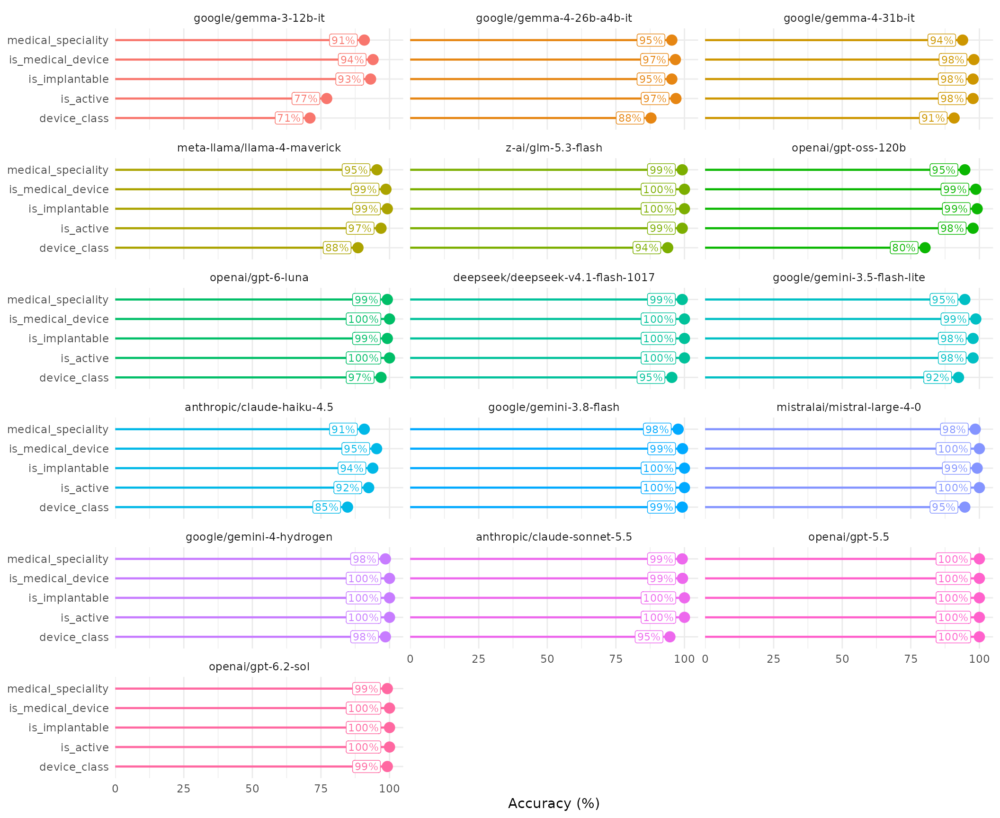

# Evaluating Models for Classifying Medical Devices

## Benchmarking LLM performance for classifying medical devices

### Benchmark results

We have assessed the performance of a range of LLM models against a test
set of 150 devices. These range from smaller, open-weight models to
frontier, closed-weight models.



### Testing an LLM

If not one of the above, we recommend testing your LLM against the test
set. For this, use the
[`evaluateDeviceClassifier()`](https://oxford-pharmacoepi.github.io/MedicalDeviceClassifier/reference/evaluateDeviceClassifier.md)
function against the test data provider by the package like below.

``` r

library(MedicalDeviceClassifier)
library(ellmer)

chat <- chat_anthropic()
res <- evaluateDeviceClassifier(chat,
                                name = benchmark_models,
                                data = device_test_set,
                                batchSize = 15L)
```

You can also use
[`evaluateDeviceClassifier()`](https://oxford-pharmacoepi.github.io/MedicalDeviceClassifier/reference/evaluateDeviceClassifier.md)
to test the impact of different batch sizes and also provide your own
custom test data.
